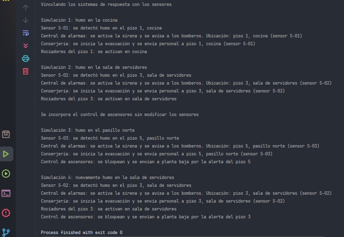

# Ejercicio 05 - Monitor de Sensores de Humos en Edificio Inteligente

## Descripción

En un sistema de seguridad contra incendios, varios sensores ubicados en distintas plantas actúan como fuentes de eventos. Cuando detectan humo deben alertar a la central de alarmas, al sistema de rociadores y a la conserjería, enviando la ubicación exacta.

## Objetivos

- Manejar escenarios con múltiples sujetos y múltiples observadores.
- Enviar la señal de emergencia con la ubicación exacta del sensor.
- Permitir que un observador escuche una o varias fuentes de peligro.
- Agregar nuevos dispositivos de respuesta sin modificar los sensores.

## Implementación del patrón Observer

Se usa la variante de varios sujetos y varios observadores.

- **Sujetos:** cada `SmokeSensor` tiene su propia lista de observadores y un método `detectSmoke`.
- **Dato enviado:** `SmokeAlert` es un `record` con el identificador del sensor, el piso y la zona.
- **Observador:** `EmergencyObserver` declara `onSmokeDetected(SmokeAlert alert)`.
- **Observadores concretos:** `AlarmCenter`, `SprinklerSystem` y `ConciergeService`.
- **Varias fuentes:** un mismo observador se suscribe a varios sensores. Los rociadores reaccionan solo si la alerta es de su piso.
- **Extensibilidad:** `ElevatorControl` se agrega al final de `Main` sin tocar ninguna clase de los sensores.

## Propósito de la clase

- `SmokeAlert`: datos de la emergencia y su ubicación.
- `EmergencyObserver`: interfaz común de los sistemas de respuesta.
- `SmokeSensor`: sujeto observable asociado a una zona.
- `AlarmCenter`: activa sirena y avisa a los bomberos.
- `SprinklerSystem`: activa los rociadores del piso que protege.
- `ConciergeService`: coordina la evacuación.
- `ElevatorControl`: dispositivo agregado posteriormente.
- `Main`: crea los sensores, suscribe los sistemas y simula distintas alertas.

## Concepto clave

Los sensores solo conocen la interfaz `EmergencyObserver`. Por eso un nuevo tipo de dispositivo se integra con solo implementar la interfaz y suscribirse, sin cambiar el código de los sensores.

## Resultado

## Conclusión

El patrón Observer permite que varios sensores y varios sistemas de respuesta interactúen de forma desacoplada. La arquitectura es abierta a la extensión y cerrada a la modificación, algo clave en un sistema de seguridad que debe crecer sin riesgos.
